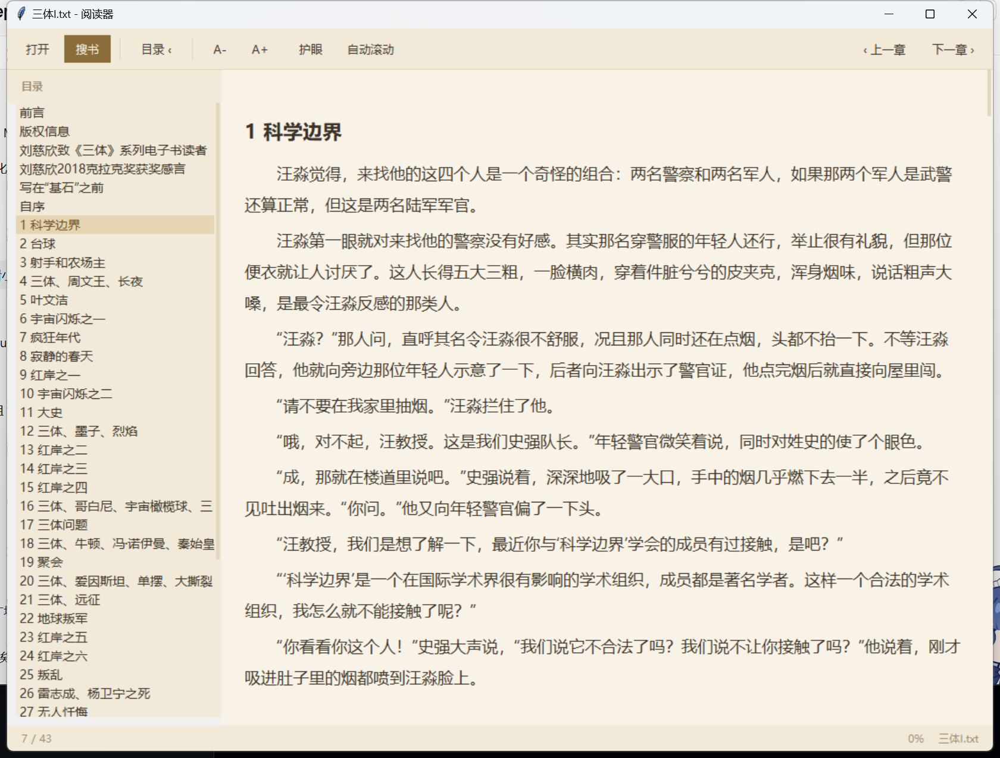

# 番茄小说阅读器

一个窗口搞定 **搜书 → 下载 → 阅读**，全部在本机跑。

不是浏览器套壳，不是第三方阅读 App：纯 Python 标准库写的桌面程序，界面全自绘，另配一个开源的本地书源后端。



## 特性

**阅读**

- 普通窗口，拖边角改大小、最大化、`F11` 全屏，最小 520×400
- `.txt` / `.epub` / `.md`，UTF-8 与 GBK 自动识别，不用管编码
- 章节自动识别，三种排版都能切：`第X章`、`Chapter N`、`分隔线 + 标题行`
- 左侧目录 `Ctrl+B` 收起，点哪章跳哪章
- 字号 14~36，`Ctrl+滚轮` 直接调
- 三套配色：浅色 / 护眼米黄 / 深色，深色下标题栏也跟着变
- 自动滚动，像提词器，滚到章末自动进下一章
- 窗口拉很宽时正文自动居中，不会拉成一条长线
- 每本书独立记进度、字号、配色、窗口位置，下次打开接着看

**搜书下载**

- 工具栏「搜书」或 `Ctrl+S`，输入书名 / 作者
- 下载全本，或先「只下前 20 章」试读
- 下载完成自动落进 `books/`，并直接在阅读器里打开

**实现**

- 零第三方依赖，只要 Python 3.9+ 和标准库
- 扁平按钮、细滚动条都是自己画的，不跟系统主题走

## 快速开始

需要 Python 3.9+（Windows 安装时记得勾选 *Add Python to PATH*）。

```bash
git clone https://github.com/SorenKang/fanqie-reader.git
cd fanqie-reader
python tools/fetch_source.py      # 拉取书源后端，约 11 MB
```

启动：

- Windows：双击 `desktop\start.bat`
- 其他平台：`python desktop/reader.py`

只想读本地书、不联搜的话，跳过 `fetch_source.py` 也行，直接启动然后「打开」选文件。

## 快捷键

| 按键 | 作用 |
|---|---|
| `Ctrl+S` | 搜书 |
| `Ctrl+O` | 打开本地文件 |
| `Ctrl+B` | 收起 / 展开目录 |
| `Ctrl+滚轮` `Ctrl+=` `Ctrl+-` | 调字号 |
| `Ctrl+T` | 换配色 |
| `[` / `]` | 上一章 / 下一章 |
| `空格` | 停下自动滚动 |
| `F11` / `Esc` | 全屏 / 退出全屏 |

## 目录结构

```
├── booklib.py              编码探测 / EPUB 抽取 / 章节切分
├── desktop/
│   ├── reader.py           阅读器 + 搜书面板
│   └── start.bat           Windows 启动脚本
├── tools/
│   ├── source.py           书源客户端：托管进程 + 封装 API
│   └── fetch_source.py     下载书源后端二进制
├── books/                  书库，下载和本地书都放这
├── vendor/                 书源后端（不进仓库，由 fetch_source.py 生成）
├── docs/screenshot.png
└── legacy/web/             早期的单文件浏览器版，仅存档
```

## 书源

搜书和下载都交给 [zhongbai2333/Tomato-Novel-Downloader](https://github.com/zhongbai2333/Tomato-Novel-Downloader)（Rust，MIT 协议）。

本项目：

- 只通过它的 `--server` 模式（`127.0.0.1:18423` 的 HTTP API）调用，不改它的源码
- 不打包、不重新分发它的二进制，由 `tools/fetch_source.py` 从上游 Releases 现拉
- 不包含任何第三方接口地址或凭证

后端进程由阅读器按需拉起（`CREATE_NO_WINDOW | DETACHED_PROCESS`），关掉阅读器它也继续驻留，下次点搜书秒开。

想改输出格式或并发，编辑 `vendor/data/config.yml`：

```yaml
novel_format: txt          # txt / epub / pdf
save_path: ''              # 留空则用 books/
max_workers: 1             # 并发，调高下载快，也更容易被限速
```

改完在任务管理器结束 `tomato-rust.exe`，下次点搜书会按新配置重起。

## 换成别的书源

`tools/source.py` 里 `TomatoSource` 就是一层的 HTTP 封装。想接别的后端，实现同样的四个方法即可：

```python
src.start()                          # 确保后端可用，返回 bool
src.search(keyword)                  # -> [{'title','author','book_id'}, ...]
src.download(book_id)                # 建任务
src.jobs()                           # -> [{'id','state','progress':{...}}, ...]
```

## 已知限制

- 书源依赖上游接口，番茄改版时可能失效，届时重跑 `fetch_source.py` 更新后端即可
- `fetch_source.py` 需要能访问 GitHub；国内网络配合代理会在系统层面自动生效
- 桌面界面只有 Windows 做过完整测试，Linux / macOS 上 `tkinter` 的中文字体表现会有差异

## License

[MIT](LICENSE)

书源后端另按上游自己的 MIT 协议授权，与本项目相互独立。
